# Stock Market Prediction Project - System Flowchart

## 🏗️ Overall System Architecture

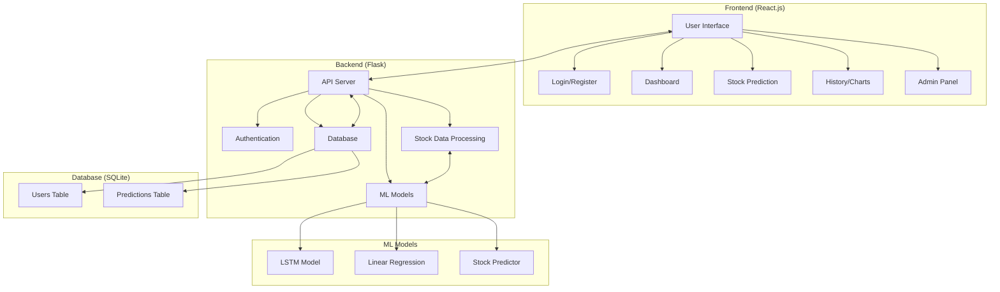

## 🔐 Authentication Flow

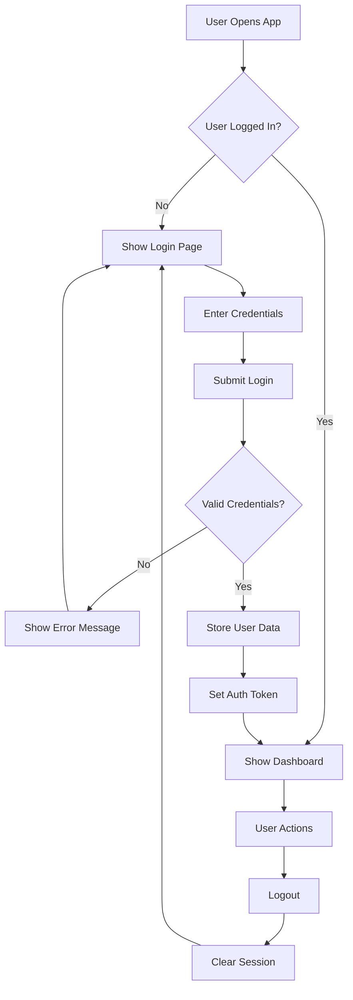

## 📊 Stock Prediction Flow

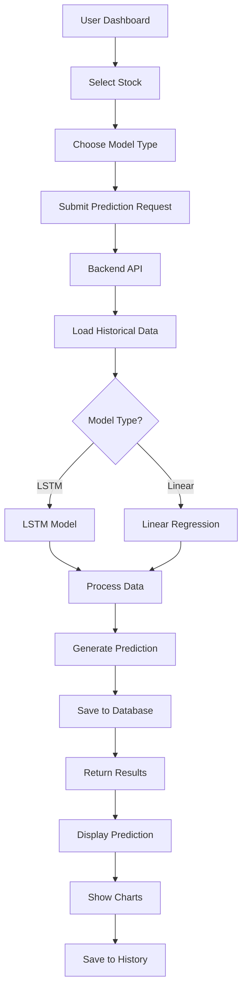

## 👥 User Management Flow

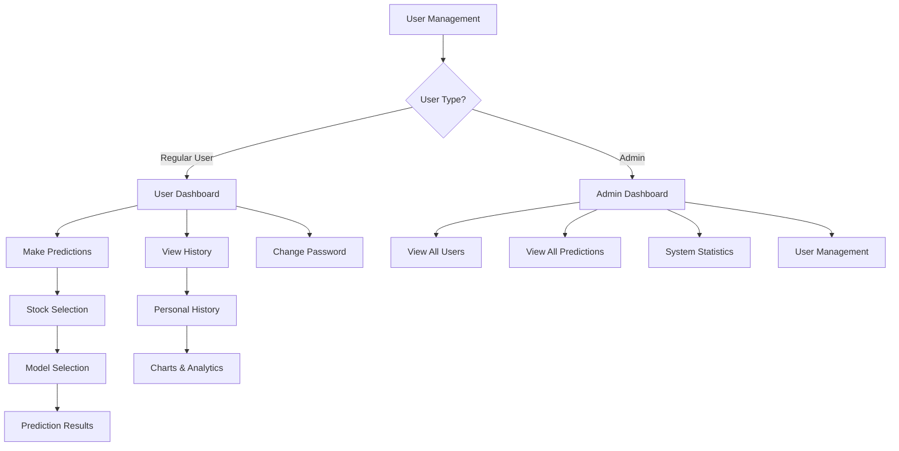

## 🔄 Data Flow Architecture

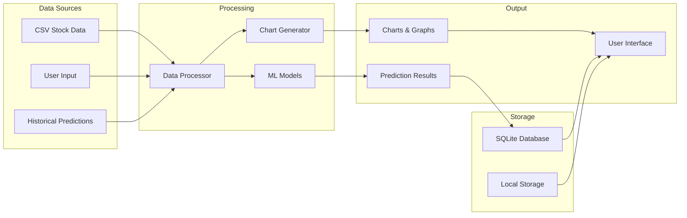

## 🛠️ API Endpoints Flow

```mermaid
flowchart TD
    A[Frontend Request] --> B{Endpoint Type?}
    
    B -->|Authentication| C[/api/login]
    B -->|Authentication| D[/api/register]
    B -->|Authentication| E[/api/logout]
    B -->|Authentication| F[/api/change-password]
    
    B -->|Stock Data| G[/api/stocks]
    B -->|Stock Data| H[/api/charts/<stock>]
    
    B -->|Prediction| I[/api/predict]
    B -->|History| J[/api/history]
    
    B -->|Admin| K[/api/admin/users]
    B -->|Admin| L[/api/admin/predictions]
    B -->|Stats| M[/api/stats]
    
    C --> N[Validate Credentials]
    D --> O[Create User]
    E --> P[Clear Session]
    F --> Q[Update Password]
    
    G --> R[Return Stock List]
    H --> S[Generate Charts]
    I --> T[Run ML Model]
    J --> U[Get User History]
    
    K --> V[Get All Users]
    L --> W[Get All Predictions]
    M --> X[Get Statistics]
```

## 🎯 User Journey Flow

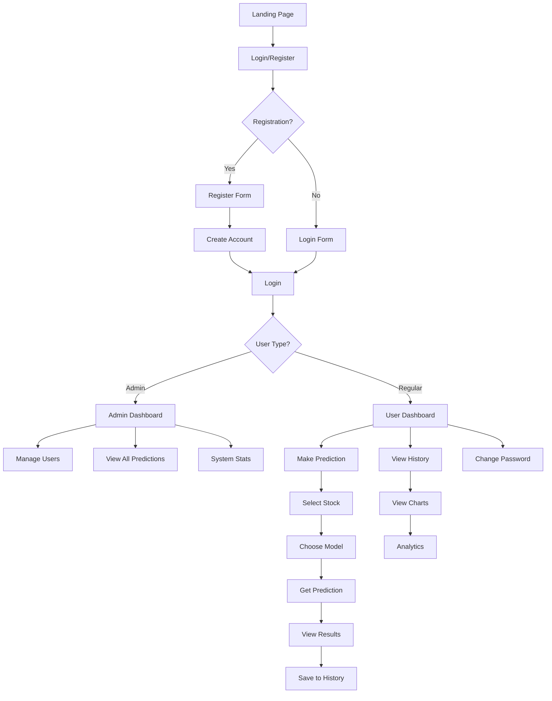

## 🔧 Error Handling Flow

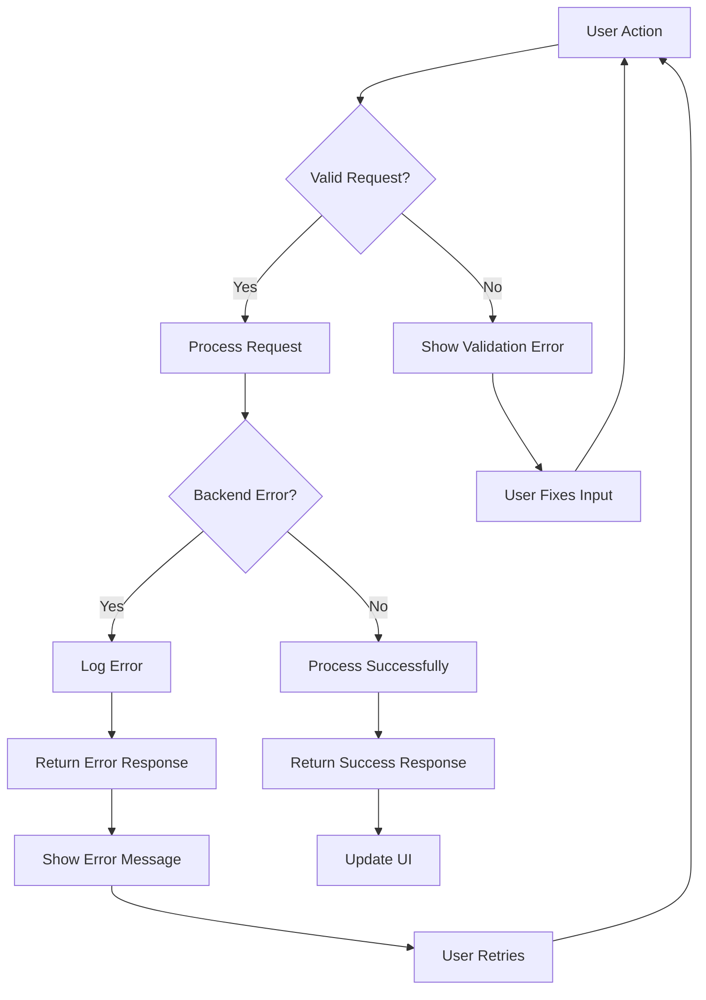

## 📈 ML Model Prediction Flow

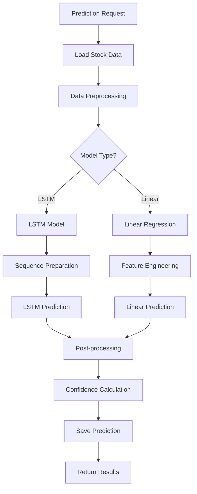

## 🎨 Frontend Component Flow

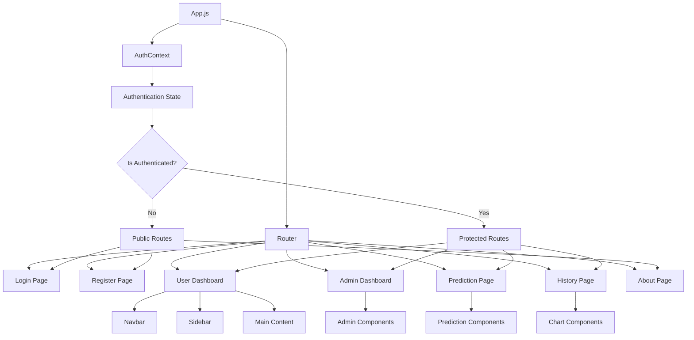

## 🔄 Session Management Flow

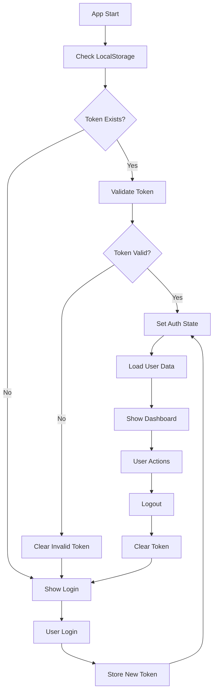

## 📊 Database Schema Flow

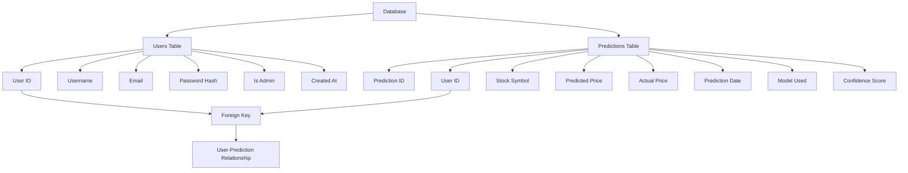

This flowchart provides a comprehensive overview of your Stock Market Prediction project's architecture, data flow, user interactions, and system components. Each diagram shows different aspects of the application from authentication to ML model predictions. 