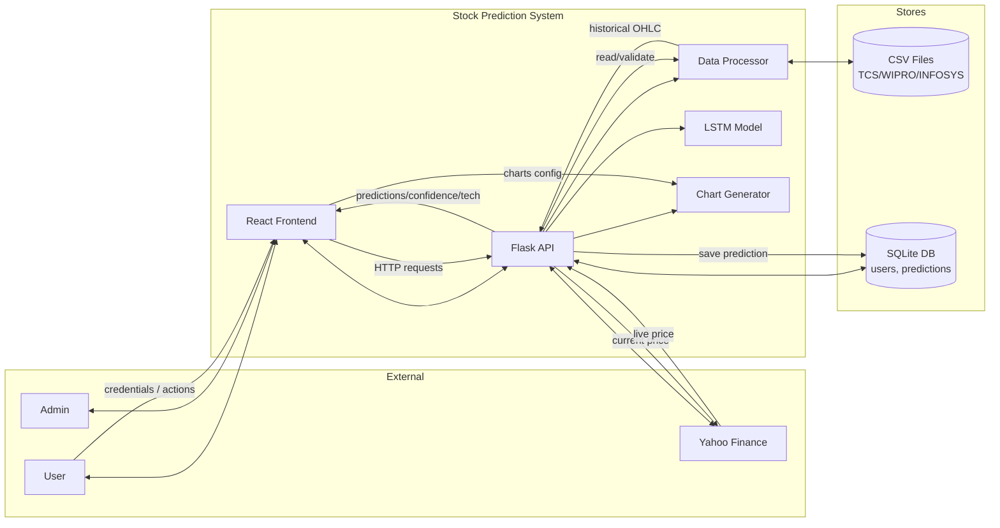
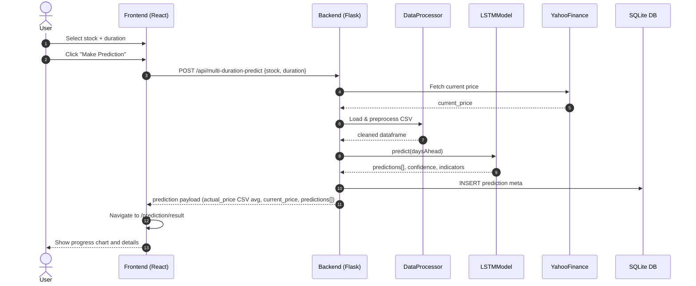
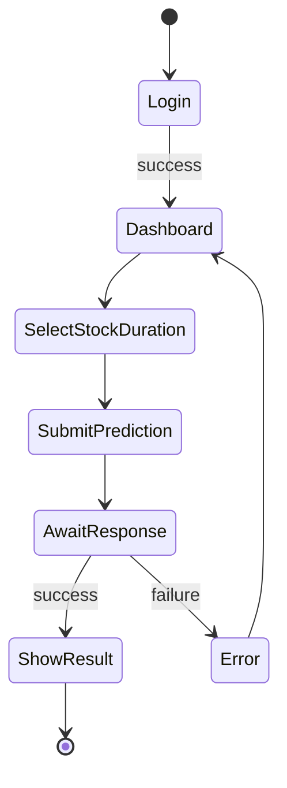
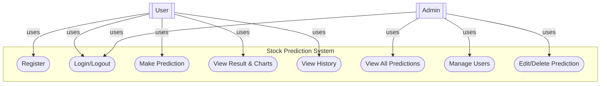

## System Diagrams

Below are Mermaid diagrams for the project. You can preview them in GitHub, VS Code (Markdown/Markdown Preview Mermaid), or with the Mermaid CLI.

### Data Flow Diagram (DFD)

### Sequence Diagram (Make Prediction)

### Activity Diagram (User Prediction Flow)

### Use Case Diagram (simplified)

